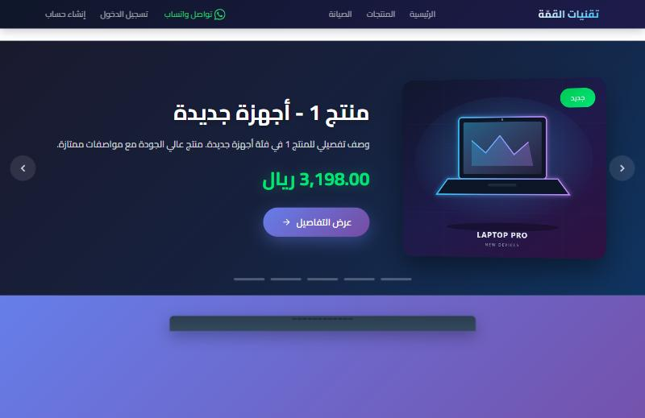
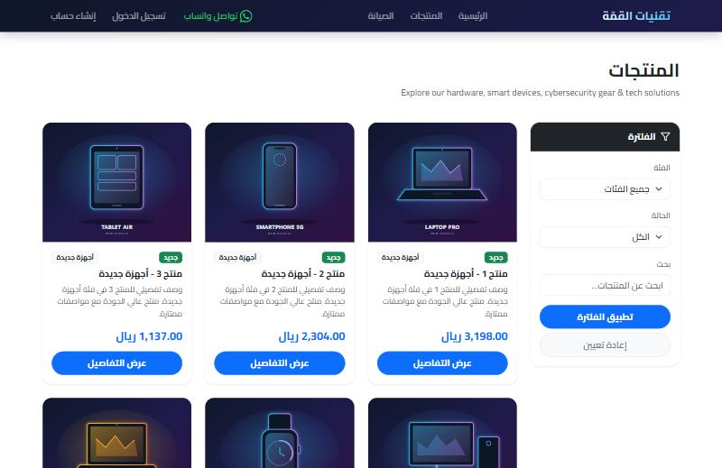
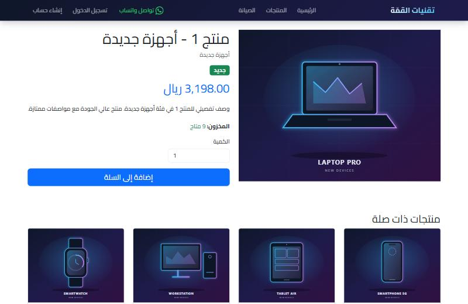
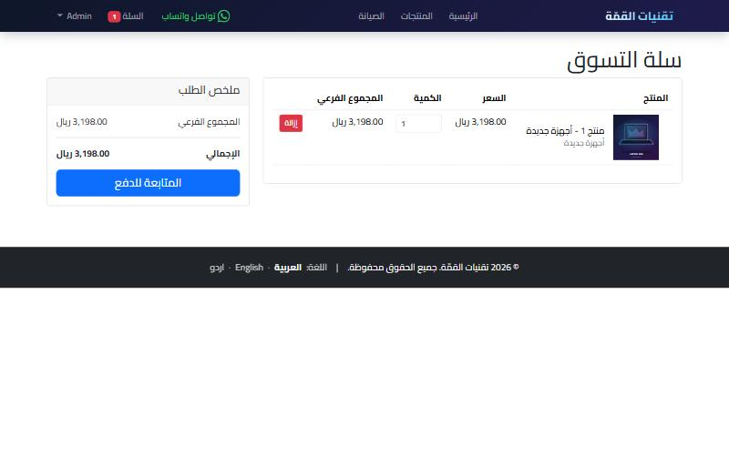
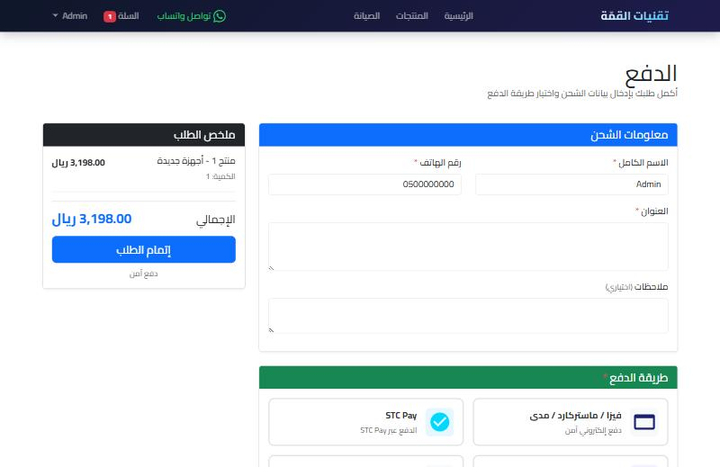
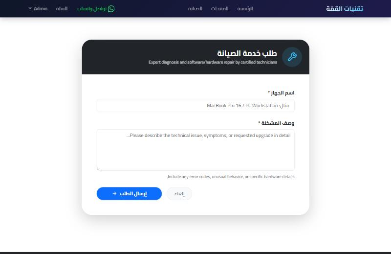
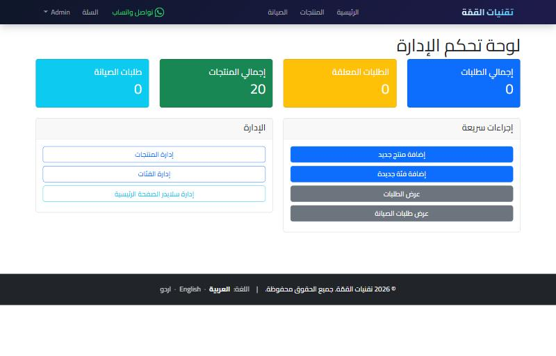
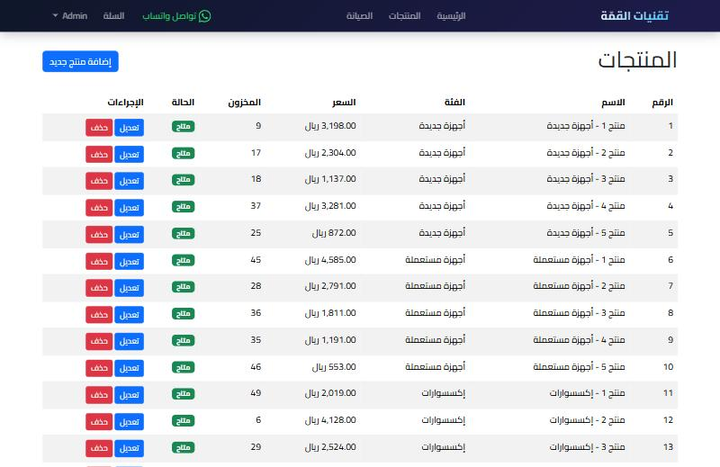

# تقنيات القمّة - Taqniyat Al-Qimmah Store

A complete Laravel e-commerce web application for buying, selling, and maintaining technology products.

## Features

- **Public Landing Page**: Browse products without login
- **Product Management**: Dynamic products with categories, images, and stock management
- **Shopping Cart**: Add products to cart and checkout
- **Order Management**: Complete order processing system
- **Maintenance Service**: Request and manage maintenance services
- **Admin Panel**: Full admin dashboard for managing products, categories, orders, and maintenance requests
- **Arabic Language Support**: Full RTL support with Arabic translations
- **Responsive Design**: Works on mobile and desktop devices

## Screenshots

### Storefront

| Home | Products |
|------|----------|
|  |  |

| Product details | Cart |
|-----------------|------|
|  |  |

| Checkout | Maintenance request |
|----------|---------------------|
|  |  |

### Admin panel

| Dashboard | Product management |
|-----------|--------------------|
|  |  |

## Requirements

- PHP >= 8.1
- Composer
- MySQL
- Node.js & NPM (for assets)

## Installation

1. Clone the repository or extract the project files

2. Install PHP dependencies:
```bash
composer install
```

3. Install Node dependencies:
```bash
npm install
```

4. Copy environment file:
```bash
cp .env.example .env
```

5. Generate application key:
```bash
php artisan key:generate
```

6. Configure your database in `.env`:
```env
DB_CONNECTION=mysql
DB_HOST=127.0.0.1
DB_PORT=3306
DB_DATABASE=taqniyat_al_qimmah
DB_USERNAME=root
DB_PASSWORD=your_password
```

7. Run migrations:
```bash
php artisan migrate
```

8. Seed the database:
```bash
php artisan db:seed
```

9. Create storage link:
```bash
php artisan storage:link
```

10. Build assets:
```bash
npm run build
```

## Default Credentials

After seeding, you can login with:

**Admin:**
- Email: admin@taqniyat.com
- Password: password

**User:**
- Email: user@test.com
- Password: password

## Usage

1. Start the development server:
```bash
php artisan serve
```

2. Visit `http://localhost:8000` in your browser

## Project Structure

- `app/Http/Controllers/` - All controllers
- `app/Models/` - Eloquent models
- `database/migrations/` - Database migrations
- `database/seeders/` - Database seeders
- `resources/views/` - Blade templates
- `routes/web.php` - Web routes
- `lang/ar/` - Arabic translations

## Features Breakdown

### Public Features
- Browse products by category
- Search products
- Filter by condition (New/Used)
- View product details
- Add to cart (requires login)
- Request maintenance (requires login)

### User Features
- User registration and login
- Shopping cart management
- Order placement and tracking
- Maintenance request submission
- Profile management

### Admin Features
- Product management (CRUD)
- Category management (CRUD)
- Order management and status updates
- Maintenance request management
- Dashboard with statistics

## Language Support

The application supports Arabic (RTL) and English. Default locale is Arabic. Translations are stored in `lang/ar/messages.php`.

## License

This project is open-sourced software licensed under the MIT license.
